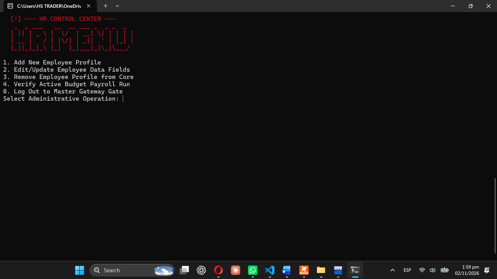
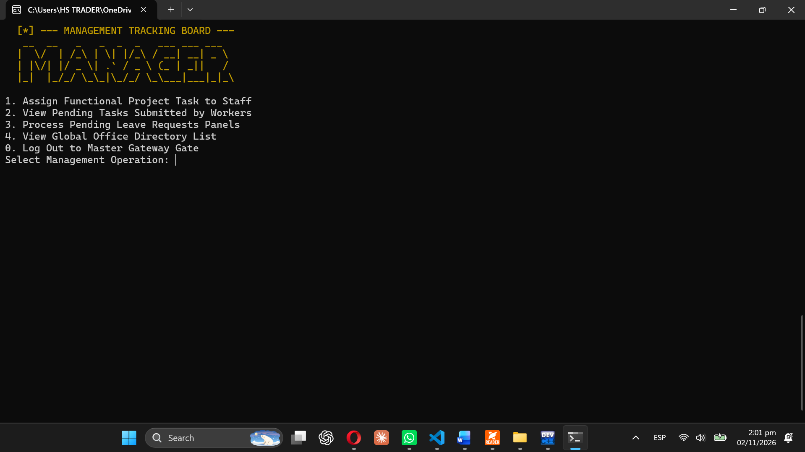
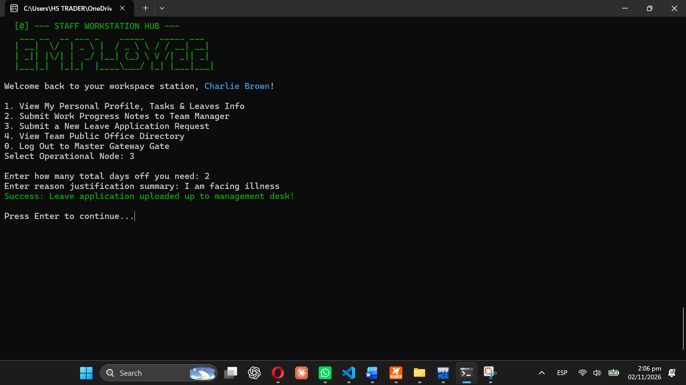

# Employee Management System

A role-based **Employee Management System** built in **C++** using **Object-Oriented Programming**. This console application simulates an office with three separate portals (**HR**, **Manager** and **Employee**), each with its own permissions for managing staff records, tasks, leave requests and payroll.

This project was developed as my **3rd-semester Object-Oriented Programming** project at the University of Lahore.

## Main Menu


## Application Screenshots

### HR Portal
Add, update and remove employee profiles, and review the payroll budget.



### Manager Portal
Assign tasks, review submitted work, and approve or reject leave requests.



### Employee Portal
View your profile, tasks and leave status, submit work and apply for leave.


### Task Assignment


### Leave Request



### Employee Directory


## Features

### Role-based login
- Choose a portal, then sign in with an employee ID.
- The ID's role must match the portal; otherwise access is denied.

### HR Portal
- Add new employees (duplicate IDs are rejected) and assign their role: HR, Manager or Employee.
- Edit an employee's name, age, department, designation or salary.
- Delete employee records.
- View payroll for every employee and the total salary budget.

### Manager Portal
- Assign a task with a deadline to an employee.
- Review tasks that employees have submitted.
- Approve or reject pending leave requests, with a note for the employee.
- View the office directory.

### Employee Portal
- View your full profile, current task and leave status.
- Submit progress notes on an assigned task.
- Apply for leave (one pending request at a time).
- View the office directory.

### Workflow statuses
- **Tasks:** None → Pending → Submitted
- **Leave:** None → Pending Approval → Approved / Rejected
- Statuses are colour-coded in the console (yellow, green, red).

## Object-Oriented Programming Concepts

| Concept | Where it appears |
|---|---|
| **Classes and objects** | The `Employee` class; every staff member is an `Employee` object in the `database` array |
| **Encapsulation** | Each employee's data, task and leave information are kept together in one class |
| **Data hiding** | All attributes are `private` and accessed only through public getters and setters |
| **Abstraction** | Users work through menus without touching the internal data |
| **Constructor** | The default constructor initialises every field, so new objects never hold garbage values |
| **Member functions** | `setTask`, `submitTask`, `requestLeave`, `processLeave`, `displayFullProfile` and more |
| **Role-based access** | Each portal checks the user's role before opening |

## Technology Stack

| Technology | Purpose |
|---|---|
| C++ (C++11 or later) | Application logic |
| Object-Oriented Programming | Program design |
| `<iomanip>` | Aligned columns in the directory and payroll |
| ANSI escape codes | Console colours and screen clearing |

## Project Structure

```text
OOP-Employee-Management-System/
│
├── src/
│   └── EmployeeManagementSystem.cpp
│
├── docs/
│   ├── screenshots/
│   │   ├── main-menu.png
│   │   ├── hr-panel.png
│   │   ├── manager-panel.png
│   │   ├── employee-panel.png
│   │   ├── task-assignment.png
│   │   ├── leave-request.png
│   │   └── employee-directory.png
│   │
│   └── reports/
│       ├── OOP-Employee-Management-System-Report.docx
│       └── OOP-Employee-Management-System-Report.pdf
│
├── Run-EmployeeSystem.bat
├── .gitignore
└── README.md
```

## Getting Started

### Requirements
- A C++ compiler such as **GCC / MinGW-w64** (`g++`), Clang or MSVC.
- A terminal that supports ANSI colours (Windows Terminal, the VS Code terminal, or any Linux / macOS terminal).

### Quickest way (Windows)
Double-click **`Run-EmployeeSystem.bat`**. It compiles the program into a `build` folder and starts it. It needs `g++` on your PATH.

### Manual
```bash
git clone https://github.com/azeemworks925-eng/OOP-Employee-Management-System.git
cd OOP-Employee-Management-System
g++ -std=c++17 src/EmployeeManagementSystem.cpp -o EmployeeManagementSystem
```

Run it on Windows with `EmployeeManagementSystem.exe`, or on Linux / macOS with `./EmployeeManagementSystem`.

### Default accounts

The program starts with three employees, one for each portal:

| Portal | Name | Employee ID |
|---|---|---|
| HR | Alice Smith | `101` |
| Manager | Bob Jones | `202` |
| Employee | Charlie Brown | `303` |

Choose a portal from the main menu, then enter the matching ID.

## Limitations

- Stores up to **100** employees in a fixed-size array.
- Data is kept in memory only and is lost when the program closes.
- Sign-in uses the employee ID only; there are no passwords.
- Each employee can have one active task and one leave request at a time.

## Future Improvements

- Save data to files or a database.
- Password-based authentication.
- Multiple tasks and a leave history per employee.
- Attendance tracking and payroll reports.
- A graphical user interface.

## Documentation

The full project report is available in [PDF](docs/reports/OOP-Employee-Management-System-Report.pdf) and [DOCX](docs/reports/OOP-Employee-Management-System-Report.docx).

## Author

**Muhammad Azeem**
BS Software Engineering, University of Lahore
GitHub: [@azeemworks925-eng](https://github.com/azeemworks925-eng)

**Course:** Object-Oriented Programming · **Semester:** 3rd · **Project type:** Semester project
