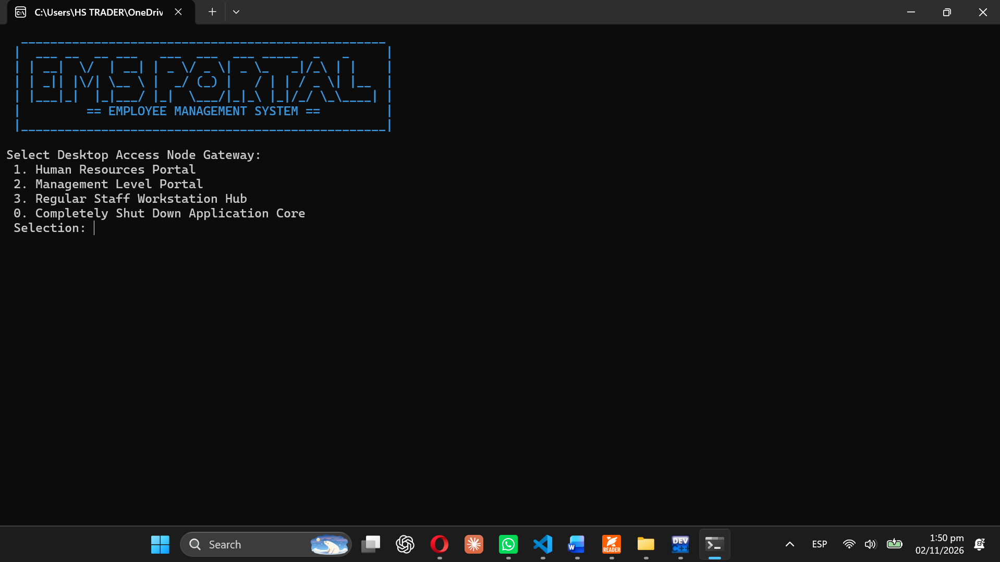
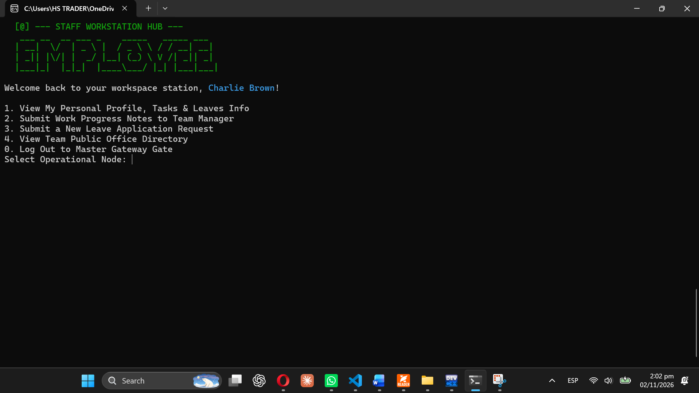
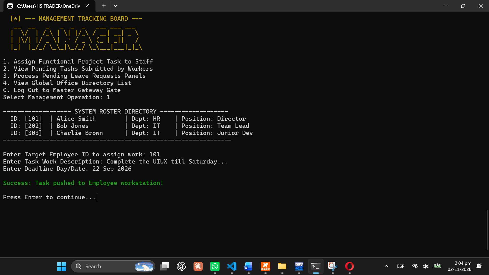
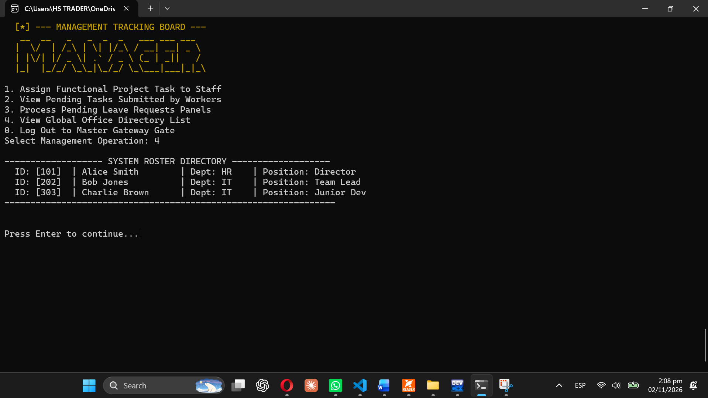

# Employee Management System

A role-based Employee Management System built in **C++** using Object-Oriented Programming (OOP) concepts. This console-based application simulates an office environment with separate portals for HR, Managers, and Employees.

## Project Overview

The Employee Management System provides different functionalities depending on the user's role. Each portal has specific permissions, allowing users to manage employee records, assign tasks, review work submissions, handle leave requests, and view payroll information.

The system is developed as an academic Object-Oriented Programming semester project.

## Screenshots

### Main Menu


### HR Portal


### Manager Portal


### Employee Portal


### Task Assignment


### Leave Request


### Employee Directory


## Features

### 1. HR Portal
- Add new employees
- Update employee information
- Delete employee records
- View employee payroll information

### 2. Manager Portal
- Assign tasks to employees
- Review submitted tasks
- Review and approve or reject leave requests
- View the employee directory

### 3. Employee Portal
- View personal profile
- View assigned tasks
- Submit work progress
- Request leave
- View the employee directory

## Object-Oriented Programming Concepts

The project demonstrates the following OOP concepts:

- **Classes and Objects:** An `Employee` class represents employee records, with objects stored in an employee array.
- **Encapsulation:** Employee attributes are declared private and accessed through public member functions.
- **Data Hiding:** Internal employee information is protected through access control.
- **Abstraction:** Users interact with the system through menus without directly accessing its internal implementation.
- **Constructors:** A default constructor initializes employee object data.
- **Role-Based Access:** Separate portals provide different functionalities for HR, Managers, and Employees.

## Technologies Used

- **Programming Language:** C++
- **Programming Paradigm:** Object-Oriented Programming
- **Compiler:** GCC / MinGW or another compatible C++ compiler
- **Interface:** Console-based application

## Default Employee IDs

The program includes three predefined employee records:

| Role | Employee Name | Employee ID |
|---|---|---|
| HR | Alice Smith | `101` |
| Manager | Bob Jones | `202` |
| Employee | Charlie Brown | `303` |

Select the relevant portal from the main menu and enter its corresponding employee ID.

## How to Run

### Requirements
- A C++ compiler such as GCC or MinGW
- A code editor or IDE such as VS Code, Code::Blocks, or Dev-C++

### Compile

```bash
g++ EmployeeManagementSystem.cpp -o EmployeeManagementSystem
```

### Run

On Windows:

```bash
EmployeeManagementSystem.exe
```

On Linux:

```bash
./EmployeeManagementSystem
```

## Project Structure

```text
OOP-Employee-Management-System/
│
├── EmployeeManagementSystem.cpp
├── Project OOP Document.docx
├── Project OOP Document.pdf
├── README.md
│
└── screenshots/
    ├── main-menu.png
    ├── hr-panel.png
    ├── manager-panel.png
    ├── employee-panel.png
    ├── task-assignment.png
    ├── leave-request.png
    └── employee-directory.png
```

## Current Limitations

- Employee records are stored in a fixed-size array with a maximum capacity of 100 employees.
- Data is stored in memory and is not permanently saved after the program terminates.
- The application uses a console-based interface rather than a graphical user interface.

## Future Improvements

- Database integration for permanent data storage
- Password-based authentication
- Graphical user interface (GUI)
- Attendance management
- More advanced payroll and reporting features

## Developed By

**Muhammad Azeem**

Bachelor of Software Engineering  
University of Lahore

## Project Information

**Subject:** Object-Oriented Programming (OOP)  
**Project Type:** Semester Project  
**Language:** C++